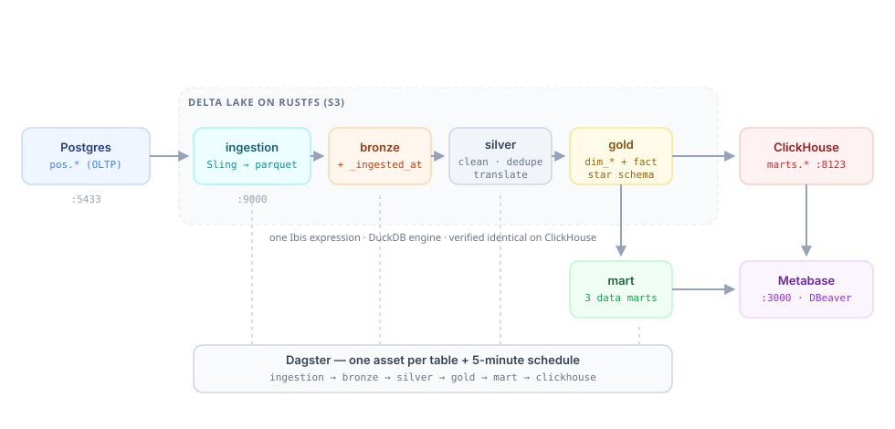
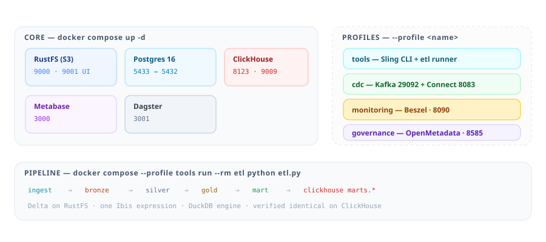
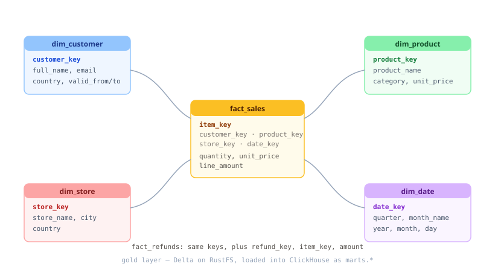

# pondhouse

A lean, fully open-source lakehouse platform. One Ibis expression runs on both
DuckDB (lake) and ClickHouse (serving) — no dbt, no Spark, no ZooKeeper, no paid tiers.

**Requirements:** Docker with Compose v2 (runs great on WSL2), ~6 GB RAM free if you
enable every profile.

## Architecture

<p align="center">
  
</p>

Alongside the batch path above, a CDC path streams changes:
`Debezium → Kafka (KRaft) → Aiven S3 sink → s3://cdc-landing/cdc/<topic>/<partition>/*.parquet`
(profile `cdc`). Monitoring (Beszel) and catalog/lineage (OpenMetadata) ship as
their own profiles.

### Services and host ports

<p align="center">
  
</p>

## Stack

| Layer | Tool | Version | Profile | Port | URL |
|---|---|---|---|---|---|
| Storage | RustFS (S3) | 1.0.4 | core | 9000 API / 9001 console | http://localhost:9001 |
| Streaming | Kafka (KRaft) | 4.0.0 | `cdc` | 29092 host / 9092 internal | — |
| CDC | Kafka Connect + Debezium + Aiven S3 sink | 3.7.0 / 3.4.3 | `cdc` | 8083 | REST API |
| Serving | ClickHouse | 26.3 | core | 8123 HTTP / 9009 native | http://localhost:8123/play |
| Viz | Metabase (on Postgres; ClickHouse driver bundled) | v0.65.2 | core | 3000 | http://localhost:3000 |
| Orchestration | Dagster | 1.13 | core | 3001 | http://localhost:3001 |
| Shared DB + demo source | Postgres (wal_level=logical) | 16 | core | 5433 → 5432 (`POSTGRES_HOST_PORT`) | — |
| Batch ingestion | Sling (in the `etl` and Dagster images) | see `uv.lock` | `tools` | — | `docker compose --profile tools run --rm etl python ingest.py` |
| Medallion ETL | Ibis + DuckDB + deltalake | see `uv.lock` | `tools` | — | `docker compose run --rm etl ...` |
| Monitoring | Beszel (hub + agent) | 0.21.1 | `monitoring` | 8090 | http://localhost:8090 |
| Governance | OpenMetadata + Elasticsearch | 1.13.3 / 9.3.0 | `governance` | 8585 / 8080 | http://localhost:8585 |

## Quickstart

```bash
cd ~/pondhouse
cp .env.example .env                       # first time only; then edit as needed

docker compose up -d                       # core: rustfs, clickhouse, postgres, metabase, dagster
docker compose --profile cdc up -d         # + Kafka + Kafka Connect (Debezium + Aiven sink)
docker compose --profile monitoring up -d  # + Beszel (hub + agent)
docker compose --profile governance up -d  # + OpenMetadata + Elasticsearch
```

All profiles combine freely, e.g. `docker compose --profile cdc --profile monitoring up -d`.

> **First boot order matters:** start the **core stack first** and let Postgres finish
> initializing — its one-shot init script (`orchestration/initdb/01_dbs.sh`) creates the
> `dagster`, `demo`, `openmetadata_db` and `airflow_db` databases. If you enable the
> `governance` profile only *after* the Postgres volume was already initialized, create
> those DBs manually (one-liner in the Governance section below).

## Repo layout

```
pondhouse/
├── docker-compose.yml      # the whole platform (core + 4 profiles)
├── .env                    # all credentials / config knobs (gitignored)
├── .env.example            # copy to .env; documents every setting
├── pyproject.toml, uv.lock # all Python dependencies, one locked set
├── docs/                   # architecture / star-schema / services diagrams (SVG)
├── ingestion/sling/        # batch ingestion: connections + replication YAMLs
├── etl/                    # demo medallion ETL: Sling (oltp->bronze) + Ibis (silver/gold/mart)
│   ├── Dockerfile          # the `etl` service image
│   └── tests/              # pytest: transforms, ingest modes, DuckDB↔ClickHouse parity
├── kafka/                  # Connect image (Debezium + Aiven sink) + connector JSONs
├── orchestration/          # Dagster: image, instance config, assets + asset checks
│   └── initdb/             # postgres bootstrap: dagster/demo/openmetadata/airflow DBs
├── scripts/                # end-to-end smoke tests (pipeline, CDC), also run in CI
└── serving/                # ClickHouse: bootstrap SQL and config
```

## Configuration (.env)

| Variable | Used by | Default |
|---|---|---|
| `S3_ACCESS_KEY` / `S3_SECRET_KEY` | RustFS, Aiven sink, Sling, DuckDB secret | `pondhouse` / `pondhouse-secret-change-me` |
| `CLICKHOUSE_USER` / `CLICKHOUSE_PASSWORD` / `CLICKHOUSE_DB` | ClickHouse | `default` / `pondhouse` / `marts` |
| `POSTGRES_USER` / `POSTGRES_PASSWORD` / `POSTGRES_DB` | Postgres superuser | `pondhouse` / `pondhouse` / `pondhouse` |
| `BIND_ADDR` | Interface all ports publish on | `127.0.0.1` |
| `ETL_SCHEDULE_CRON` | Dagster + APScheduler cadence | `*/5 * * * *` |
| `ALERT_WEBHOOK_URL` | Dagster failure alerts (Slack or Discord webhook) | *(empty: only logged)* |
| `BESZEL_AGENT_KEY` | Beszel agent auth | *(paste from Beszel UI)* |
| `OM_VERSION` | OpenMetadata + ingestion image tag | `1.13.3` |
| `OM_FERNET_KEY` | OpenMetadata secret key; **required** for `governance` | *(generate)* |
| `OM_DB_PASSWORD` / `AIRFLOW_DB_PASSWORD` / `AIRFLOW_ADMIN_PASSWORD` | OpenMetadata + Airflow | dev defaults |

Every port publishes on `127.0.0.1` only. Change the defaults before setting
`BIND_ADDR` to anything else. All credentials live in `.env`; nothing in the repo
holds a real secret.

### Upgrading an existing install

- Add the new settings from `.env.example` to your `.env`.
- Dagster now keeps its state in Postgres, as its config always intended. Earlier
  installs silently used SQLite in the `dagster-home` volume, so old run history
  does not carry over. Once you don't need it: `docker volume rm pondhouse_dagster-home`.
- Containers no longer have fixed names, so stop the old ones first:
  `docker compose down --remove-orphans`. Data volumes are kept.
- `orchestration/initdb/01_dbs.sh` runs only on a fresh Postgres volume, so existing
  database passwords stay as they are.
- Rebuild the images: `docker compose build`. Sling is now inside the `etl` and Dagster
  images, so remove the old container with `docker compose --profile tools down
  --remove-orphans`. `SLING_USER` is no longer used.
- `etl.py --ingest`/`--mode` and `bronze.py --source-format` are gone: Sling is the only
  ingestion path. Delta tables from the old custom path stay at `s3://lake/ingestion/{table}/`
  unused, and can be deleted once you don't need them.
- The next `serve.py` or Dagster run replaces each `marts.*` table with a native one. This
  leaves the lake data untouched, and table and column names stay the same.
- Dagster now has one asset per table, so old assets such as `bronze_layer` stay in its
  history but are no longer built.
- **Metabase moved from its H2 file to Postgres.** To keep your dashboards, run this
  before starting the new Metabase:

  ```bash
  docker compose stop metabase
  bash scripts/migrate_metabase_h2.sh
  ```

  The H2 file stays in the `metabase-data` volume. If Metabase already started and shows
  its setup screen, nothing is lost: run the script with `--replace-existing`, which
  deletes the new `metabase` Postgres database first, including anything created there.
  Keep the volume until you've checked your dashboards.

## Backups

`scripts/backup.sh` saves every Postgres database (including Metabase's dashboards and
Dagster's history) and the `lake` and `cdc-landing` buckets to `backups/<timestamp>/`:

```bash
bash scripts/backup.sh                                 # keeps the newest 7
BACKUP_DIR=/mnt/d/pondhouse-backups BACKUP_KEEP=14 bash scripts/backup.sh
```

Nothing runs it for you, so schedule it, for example with cron:

```cron
0 2 * * * cd $HOME/pondhouse && bash scripts/backup.sh >> $HOME/pondhouse-backup.log 2>&1
```

- **Copy backups off this machine.** By default they sit on the same disk as the data.
- **Treat them as secrets.** They hold password hashes and Metabase's stored connection
  details. `backups/` is ignored by git and readable only by you.
- **Avoid running one during a pipeline run.** The script compares object counts and fails
  if the lake changed during the copy; run it again if so.
- A backup appears under its final name only after its dumps and object counts are verified.
- ClickHouse isn't backed up, because its marts are rebuilt from the lake.

To restore, which **replaces** the current databases and buckets:

```bash
bash scripts/restore.sh backups/<timestamp> --yes
docker compose --profile tools run --rm etl python serve.py   # reload the marts
```

Restoring drops any Debezium replication slot, and CDC creates a new one when it restarts.
Restore has been tested with the core databases, not with OpenMetadata's.

## Failure alerts

Set `ALERT_WEBHOOK_URL` in `.env` to a Slack or Discord incoming webhook, then recreate
Dagster with `docker compose up -d dagster-webserver dagster-daemon`. Each run sends at
most one message: when it fails, or when it succeeds but data-quality checks failed.
Without a URL, alerts only go to the `dagster-daemon` log. Delivery depends on
`dagster-daemon` running, so nothing is sent if the whole stack is down.

## Memory limits

Every core and `cdc` service has a `mem_limit` in `docker-compose.yml`, set above its
measured peak on the demo data. Java services also have a capped heap. A service that
exceeds its limit is killed, so raise the limit as your data grows; the three smoke tests
fail if any container was killed this way. The `monitoring` and `governance` profiles have
no limits yet, because they haven't been measured.

## CDC pipeline

Once the `cdc` profile is up, register the connectors:

```bash
curl -X POST http://localhost:8083/connectors -H "Content-Type: application/json" \
  -d @kafka/connectors/debezium-postgres.json   # source: demo DB -> topics demo.*

curl -X POST http://localhost:8083/connectors -H "Content-Type: application/json" \
  -d @kafka/connectors/aiven-s3-sink.json       # sink: topics -> parquet on RustFS

# Credentials are read from the connect container's environment (${env:NAME}).
# manage:  curl http://localhost:8083/connectors/<name>/status
#          curl -X DELETE http://localhost:8083/connectors/<name>
```

Flow: Debezium → Kafka topics (`demo.<schema>.<table>`) → Aiven sink →
`s3://cdc-landing/cdc/<topic>/<partition>/<offset>.parquet`, readable with DuckDB.
`bash scripts/smoke_cdc.sh` proves the whole path end to end. The landing files are
not yet consumed by the medallion pipeline, which reads the batch ingestion layer.

The bundled Postgres doubles as a demo CDC source (database `demo`, `wal_level=logical`).

## Demo ETL (retail POS: Sling → Ibis → Delta → ClickHouse)

A self-contained retail medallion pipeline in `etl/`, using **Delta** tables on
RustFS and **Ibis** (DuckDB) for all transformations. The gold layer is a star
schema:

<p align="center">
  
</p>

- **`pos`** — retail source in the `demo` DB (`stores`, `products`, `customers`,
  `transactions`, `transaction_items` + `category_ref`/`status_ref`/`country_ref`
  lookups), seeded by `etl/sql/00_init.sql`.
- **`bronze`** — raw **Delta** copy + `_ingested_at` (`etl/bronze.py`), from the Sling
  parquet landing (`pos.*` → `s3://lake/ingestion/{table}.parquet`).
- **`silver`** — **translate** (join lookups → names), **cleanse**, **deduplicate**;
  rows that can't become a sale are kept in `silver.rejected_sales`.
- **`gold`** — star schema (`dim_customer`/`dim_product`/`dim_store`/`dim_date`, `fact_sales`).
- **`mart`** — data marts (`daily_sales_mart`, `product_sales_mart`, `customer_sales_mart`).
- **`marts`** — native ClickHouse tables loaded from gold + mart by `etl/serve.py`. Each
  one is built separately and swapped in atomically, so a failed load leaves the old data
  serving, and queries keep working if RustFS is down.

Everything runs in Docker — no local Python needed:

```bash
docker compose up -d postgres rustfs clickhouse createbuckets   # core services

# seed the POS source (once)
docker compose exec -T postgres \
  psql -U pondhouse -d demo -v ON_ERROR_STOP=1 < etl/sql/00_init.sql

# the whole pipeline: ingest -> bronze -> silver/gold/mart -> clickhouse
docker compose --profile tools run --rm etl python etl.py

# add source rows, then re-run
docker compose --profile tools run --rm etl python generate_data.py --rows 5

# tests — includes DuckDB vs ClickHouse parity
docker compose --profile tools run --rm -e CLICKHOUSE_HOST=clickhouse etl \
  python -m pytest tests/ -q

# end-to-end checks; isolated projects, safe next to a live stack
bash scripts/smoke_test.sh   # the pipeline, with exact revenue
bash scripts/smoke_ops.sh    # Metabase migration, backup and restore, alerts
```

Or run it as a **Dagster** asset graph (ingestion → bronze → transform → serve,
with data-quality asset checks from `etl/checks.py`) from http://localhost:3001, or headless:

```bash
docker compose up -d dagster-webserver dagster-daemon
docker compose exec -w /opt/dagster -e PYTHONPATH=/opt/dagster \
  dagster-webserver dagster asset materialize --select '*' -m repo.definitions
```

- The **scheduler** (`etl/scheduler.py`, APScheduler) inserts a new POS transaction
  each cycle, then runs the whole pipeline. Cadence is `ETL_SCHEDULE_CRON`.
- Full reference: **`etl/README.md`**. The same `pos` tables can also feed the CDC
  pipeline above.

### Querying the marts (Metabase, DBeaver, any JDBC client)

ClickHouse publishes HTTP on **8123** and the native protocol on **9009**
(container 9000 is remapped because RustFS owns 9000 on the host). DBeaver's
ClickHouse driver uses HTTP, so connect with:

| Setting | Value |
|---|---|
| Host / Port | `localhost` / **8123** |
| Database | `marts` |
| User / Password | `default` / `pondhouse` (`.env`) |

```bash
curl -s -u "$CLICKHOUSE_USER:$CLICKHOUSE_PASSWORD" http://localhost:8123/ \
  --data-binary 'SELECT * FROM marts.daily_sales_mart ORDER BY date_key FORMAT Pretty'
```

## Monitoring (Beszel)

One-time key setup:

```bash
docker compose --profile monitoring up -d   # hub on :8090, agent starts after key
```

1. Open http://localhost:8090 → create the admin account.
2. **Add System** → host `host.docker.internal`, port `45876`.
3. Copy the generated **public key** into `.env` as `BESZEL_AGENT_KEY=ssh-ed25519 ...`.
4. `docker compose --profile monitoring up -d` again — the agent connects.

The agent reads per-container Docker stats via the read-only `docker.sock` mount and
host stats via host networking.

## Governance (OpenMetadata)

Integrated in the main compose under the `governance` profile (adapted from the
official OpenMetadata 1.13.3 Postgres compose, wired to the shared Postgres):

```bash
docker compose --profile governance up -d
```

- UI: http://localhost:8585 — login `admin@open-metadata.org` / `admin`
- Airflow (ingestion pipelines): http://localhost:8080 — `admin` / `admin`
- Set `OM_FERNET_KEY` in `.env` first: `openssl rand -base64 32`
- Elasticsearch needs `vm.max_map_count=262144` on the host (one-time):
  `sudo sysctl -w vm.max_map_count=262144`
- First boot takes a few minutes while the `openmetadata-migrate` one-shot runs DB migrations.
- Then add services in the UI for ClickHouse, Metabase, Dagster, Kafka and the
  S3/Delta lake (RustFS) to get catalog + lineage.
- If the Postgres volume was initialized *before* the governance profile existed, create
  OM's databases manually:
  `docker compose exec postgres bash /docker-entrypoint-initdb.d/01_dbs.sh`
- Upgrade via `OM_VERSION` in `.env`.

## DBeaver (and other host clients)

`serving/config.d/listen.xml` sets `listen_host=0.0.0.0` so the published ports
reach the server from the host. Connect DBeaver via HTTP: host `localhost`, port
`8123`, database `marts`, user `default`, password from `.env`
(`CLICKHOUSE_PASSWORD`). Native TCP also available on port `9009`.

## Dependencies

All Python dependencies are in `pyproject.toml`, with exact versions in `uv.lock`, so
every image and CI job gets the same set. To change one:

```bash
docker run --rm -v "$PWD:/w" -w /w -u "$(id -u):$(id -g)" -e UV_CACHE_DIR=/tmp/uv \
  python:3.12-slim sh -c "pip install -q --target /tmp/u uv==0.13.7 && PYTHONPATH=/tmp/u python -m uv lock --upgrade-package duckdb"
```

Dependabot proposes weekly updates for Python, images and GitHub Actions; CI, including
the end-to-end smoke tests and a blocking vulnerability scan, decides if they are safe.

## Overlapping components (by design)

- **Dagster vs OM's Airflow** — same category, different scope. The Airflow inside the
  `ingestion` container is OpenMetadata's internal pipeline engine (required by the OM
  server); never add your own DAGs there. Dagster is *your* orchestrator.
- **Sling vs Debezium** — complementary: polling-based batch vs log-based CDC.
- **DuckDB vs ClickHouse** — intentional: compute engine vs serving engine.
